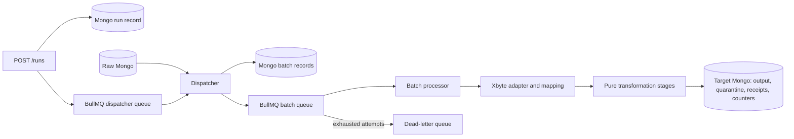

# Architecture

## Responsibilities

| File | Responsibility |
|---|---|
| `scripts/seed-raw.ts` | Stream downloaded files into raw collections |
| `runs/runs.service.ts` | Create, inspect and finish runs; save scheduling progress |
| `queue/queues.module.ts` | Redis connection and BullMQ queues |
| `queue/queue.service.ts` | Worker registration and terminal failure handling |
| `queue/dispatcher.service.ts` | Read source IDs in pages; save and enqueue batches |
| `queue/batch-processor.service.ts` | Transform batch documents and save results |
| `providers/xbyte/adapter.ts` | Expand provider envelopes and apply its field mapping |
| `providers/xbyte/mapping.ts` | Plain field-name mapping and provider conversions |
| `core/pipeline.ts` | Validate, normalize, map, project and deduplicate |
| `core/schemas.ts` | Allowed fields and validation rules for target entities |
| `core/helpers.ts` | Small text/number conversions and deterministic hashing |
| `persistence/source.repository.ts` | Read-only raw Mongo access |
| `persistence/work.repository.ts` | Batch records, entity upserts, quarantine, counters and processing receipts |

A new provider implements `Adapter`, its raw collection map and declarative field mapping, then replaces the `ADAPTER` binding. The core pipeline does not need provider-specific changes. This submission selects one provider per deployment.

## Target model

Keys begin with provider `p` (currently `xbyte-talabat`). `_id` indexes enforce uniqueness.

| Collection | Natural key / data | Lookup indexes |
|---|---|---|
| locations | `p/locations/{locationId}`; name, slug | `_id` |
| restaurants | `p/restaurants/{outletId}`; name, canonical URL, profile, separate sourceRestaurantId | `_id` |
| service_areas | Provider + restaurantKey + locationKey | locationKey, restaurantKey |
| categories | `p/categories/{outletId}/{categoryId}`; name, restaurantKey | restaurantKey |
| items | `p/items/{outletId}/{itemId}`; name, description, integer priceMinor, AED, image | restaurantKey |
| category_items | Provider + categoryKey + itemKey | categoryKey/itemKey and itemKey |

Embed small scalar profiles. Reference categories, items and memberships because these arrays grow independently. Incomplete sample exports may reference locations absent from the downloaded locations file; preserve their natural keys rather than inventing records.

## Deterministic writes

The adapter assigns a version ordered by profile authority, source timestamp and source envelope ID. The core adds a content digest as a final tie-break. Menu profiles outrank sparse listings.

For each entity, `saveEntity()` inserts missing keys and replaces existing records only when the stored `_version` is lower. Older observations cannot overwrite newer ones.

## Progress and basic recovery

1. Save the run and enqueue its dispatcher job directly.
2. For each page, save a batch, enqueue it with a stable job ID, then advance the source checkpoint. A dispatcher retry can repeat a page safely because completed jobs retain their IDs.
3. Check receipt key `{run}/{source}/{sourceId}`. If it exists, skip that document. Otherwise save its entities, upsert quarantine issues, update counters, then save the receipt.
4. Mark the batch completed after all its documents finish. Finish the run only after scheduling is done and no pending batches remain.
5. Dependency errors fail BullMQ jobs. Configurable attempts and exponential backoff apply. On terminal batch failure, quarantine documents without receipts, mark the batch dead and publish a DLQ reference.

These operations are separate. A crash before the receipt is saved can leave partial output or inaccurate counters. A standalone MongoDB server is sufficient; transactions would require a replica set.

BullMQ handles ordinary worker stalls and retries while Redis retains its jobs. There is no reconciler or transactional outbox: a crash between run creation and enqueueing, or loss of Redis jobs, needs manual intervention or a new run. Source data must stay immutable. Run one application instance.
